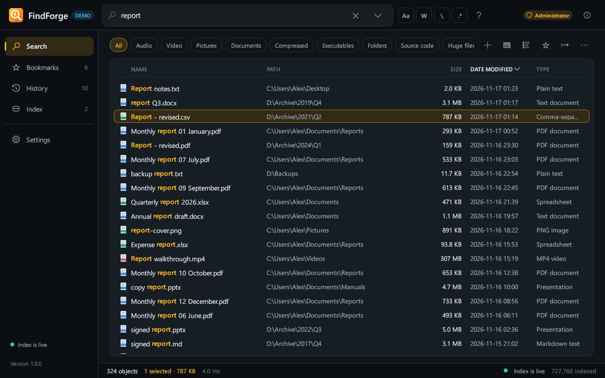
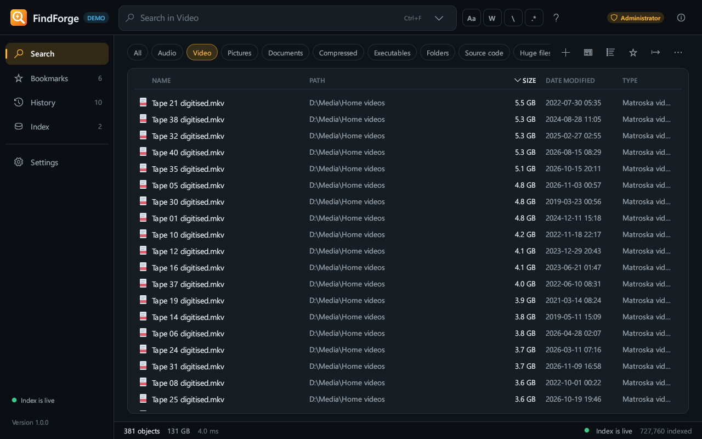
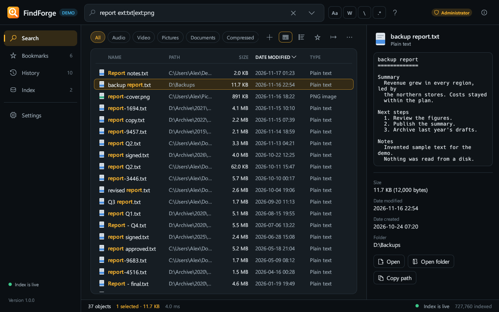
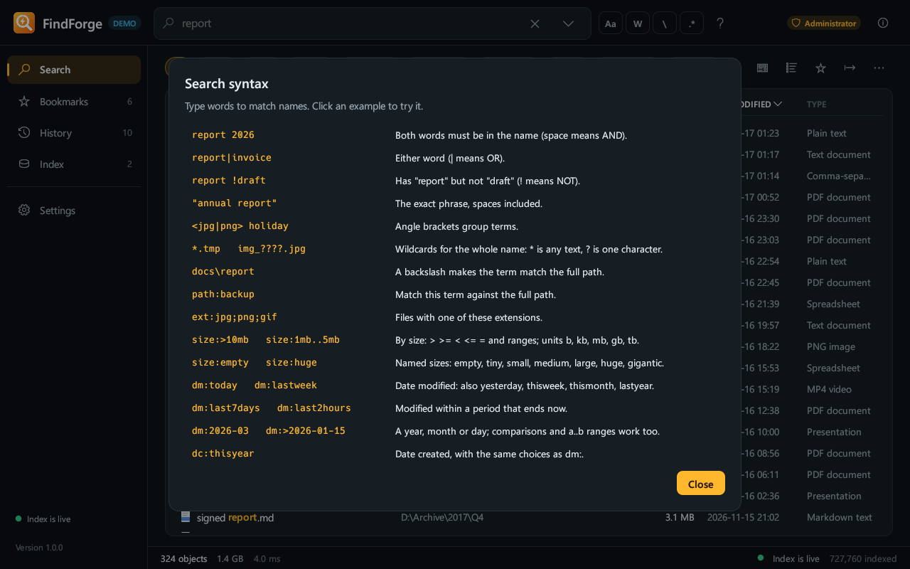
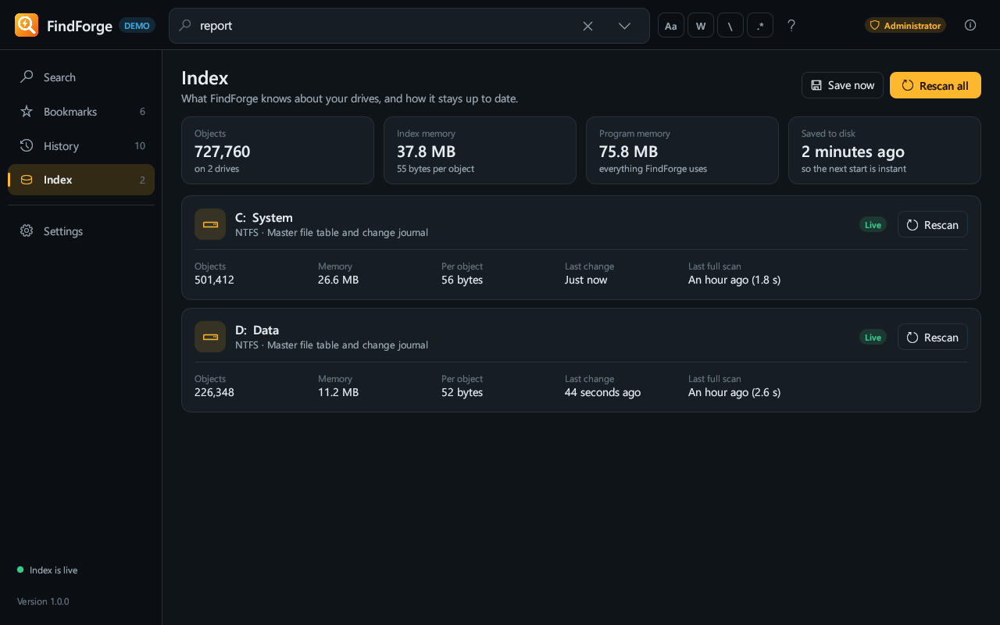
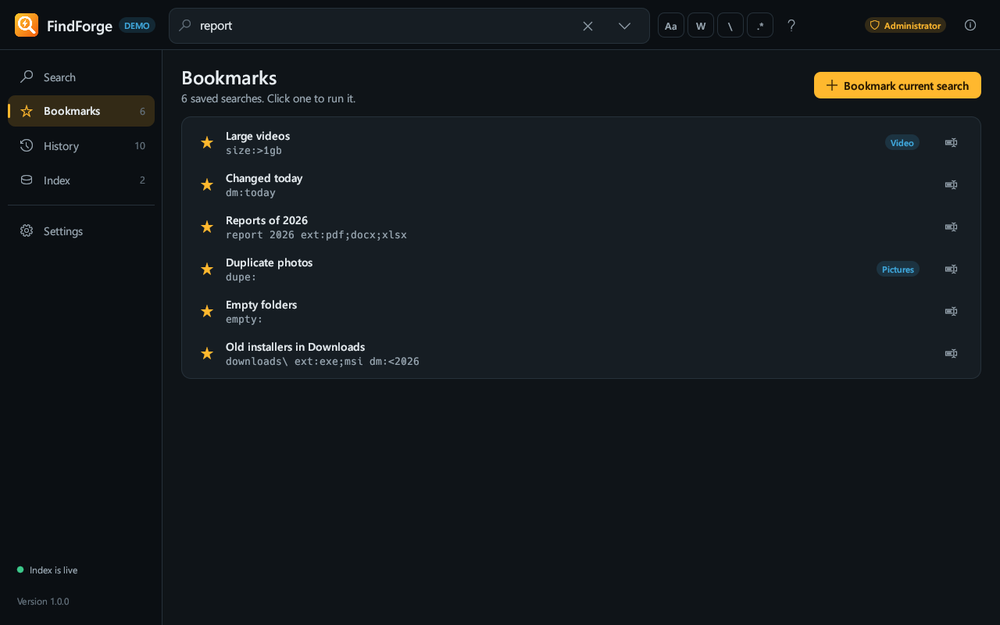
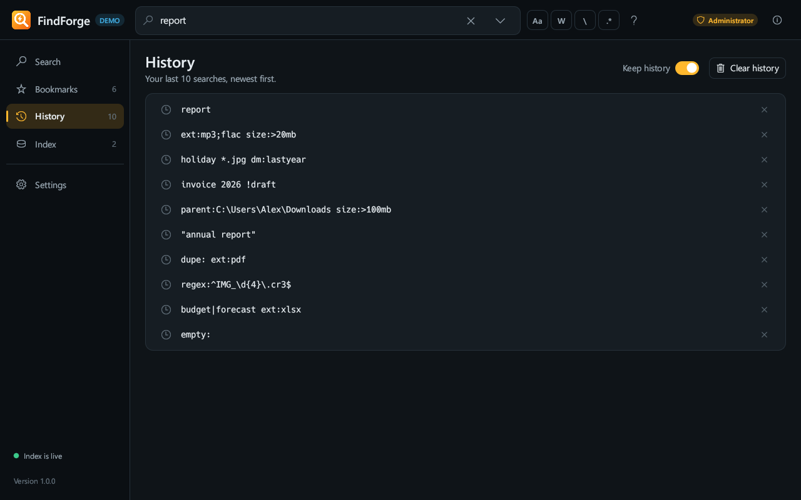
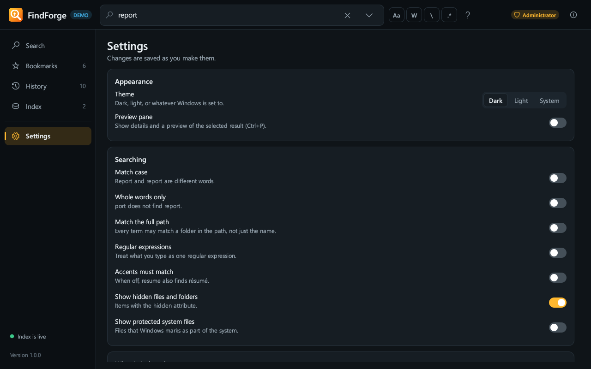
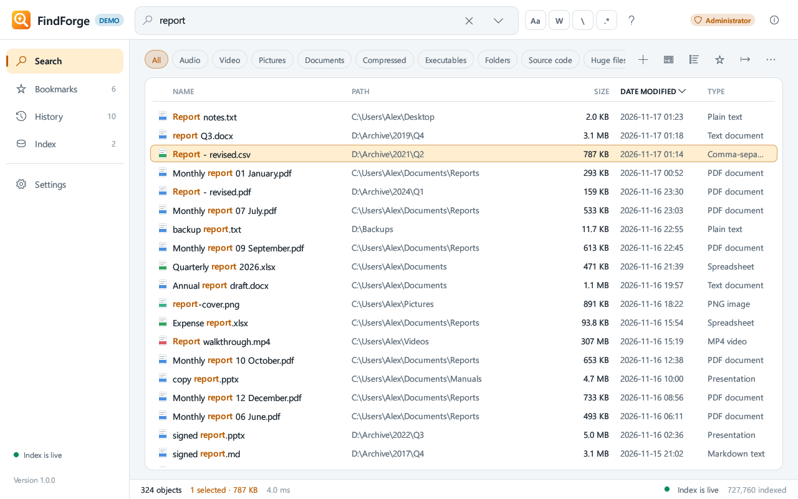

<div align="center">


# FindForge

### Find any file by name, as you type.

An instant file search for Windows, written in **Rust**.
FindForge indexes the names of every file and folder on your drives, keeps the index up to date as files change, and shows results while you are still typing.

<p>
  
  
  
  
</p>

<p>
  
  
  
  
  
  
</p>

[**Features**](#-features) ·
[**Search syntax**](#-search-syntax) ·
[**Screenshots**](#%EF%B8%8F-screenshots) ·
[**Download**](#-download) ·
[**Speed**](#-speed) ·
[**Developer**](#-developer)



</div>

---

> [!NOTE]
> **First release.** FindForge has two ways to build its index. The standard way (a parallel walk of your folders, with live updates) has been run on a real drive with 5.9 million files. The fastest way (reading the NTFS file table and change journal as administrator) is included but has so far been tested only against synthetic data, not on a real drive.

## ✨ Features

<table>
<tr>
<td width="50%" valign="top">

### ⚡ Search as you type
- Results appear while you type
- Matches highlighted in every name
- Name, path, size, dates and type; sortable columns and a column chooser
- Ready-made filters: Audio, Video, Pictures, Documents, Compressed, Executables, Folders, and your own
- Optional preview pane

</td>
<td width="50%" valign="top">

### 🔄 A live index
- Indexes file and folder names on all your drives
- Stays up to date as files are created, renamed, moved and deleted
- Saved to disk, so the next start is instant
- Exclude lists, and a choice of which drives to index
- An index page showing entries, memory and last update

</td>
</tr>
<tr>
<td valign="top">

### 🧰 Act on results
- Open, open containing folder, copy name or path
- Rename and delete (to the Recycle Bin)
- Multi-select, keyboard-first
- Export results to CSV or text
- Bookmarks and search history

</td>
<td valign="top">

### 🖥️ Always at hand
- Global hotkey to bring the window up
- Tray icon; closing hides to the tray
- Optional start with Windows
- Command line: `FindForge.exe -s "query"` prints results
- Dark and light themes

</td>
</tr>
</table>

## 🔎 Search syntax

| Type | Meaning |
|---|---|
| `report 2026` | Both words (AND) |
| `report \| invoice` | Either word (OR) |
| `report !draft` | Not containing "draft" |
| `"annual report"` | Exact phrase |
| `*.pdf`, `img_????.jpg` | Wildcards |
| `ext:jpg;png` | By extension |
| `size:>10mb` | By size |
| `dm:today`, `dc:2026` | By date modified or created |
| `type:folder` | Folders or files only |
| `parent:Downloads`, `drive:D` | By location |
| `dupe:` | Names that appear more than once |
| `empty:` | Empty files and folders |

Buttons next to the search box switch on match case, whole word, match path and regular expressions. The **?** button shows the full list.

## 🖼️ Screenshots

<table>
<tr>
<td width="50%" align="center"><b>Filters</b><br></td>
<td width="50%" align="center"><b>Preview pane</b><br></td>
</tr>
<tr>
<td width="50%" align="center"><b>Syntax help</b><br></td>
<td width="50%" align="center"><b>Index status</b><br></td>
</tr>
<tr>
<td width="50%" align="center"><b>Bookmarks</b><br></td>
<td width="50%" align="center"><b>History</b><br></td>
</tr>
<tr>
<td width="50%" align="center"><b>Settings</b><br></td>
<td width="50%" align="center"><b>Light theme</b><br></td>
</tr>
</table>

<sub>Screenshots use the built-in demo mode (<code>FindForge.exe --demo</code>), with an invented index.</sub>

## 📥 Download

Get it from the [**latest release**](https://github.com/zheerkhalid/findforge/releases/latest):

| File | What it is |
|---|---|
| `FindForge-Setup.exe` | Installer with shortcuts and an uninstaller |
| `FindForge-x.y.z-portable-x64.zip` | Portable: unzip and run |
| `FindForge.exe` | The bare 6.2 MB EXE |

FindForge works without administrator rights. **Restart as administrator** (or the "always run as administrator" setting) switches to the fastest indexing method and includes folders your account cannot open.

## 🚀 Speed

Measured on a real system drive with **5.9 million** files and folders, without administrator rights, while the PC was busy:

| | |
|---|---|
| First index | 87 seconds |
| Later starts | under a second to load the saved index |
| Memory | 377 MB (about 67 bytes per entry) |
| Typical word search, sorted | about 43 ms |
| Listing and sorting everything | about half a second |

Good to know:

- FindForge searches **names and paths**, not the contents of files.
- Without administrator rights, folders your account cannot open are not indexed.
- FAT, exFAT and network drives are rescanned on a timer rather than watched live.
- A background service, so the fast method works without an administrator prompt, is not part of this version.

## 🏗️ Build from source

Requires Rust (stable, MSVC toolchain) on Windows.

```powershell
git clone https://github.com/zheerkhalid/findforge
cd findforge
cargo build --release
# -> target\release\FindForge.exe
cargo test
```

| Command | What it does |
|---|---|
| `FindForge.exe --demo` | An invented index |
| `FindForge.exe -s "query" [--limit N] [--csv]` | Search from the command line |
| `FindForge.exe --bench [drive]` | Measure indexing on a drive (run as administrator for the fast method) |
| `FindForge.exe --selftest` | Index a temp folder, change files, and check the index follows |

The icon is drawn in code at build time. The C runtime is linked statically, so the EXE runs on a clean Windows install.

## 👨‍💻 Developer

<table>
<tr>
<td align="center" width="140">
  <a href="https://zheer.dev">
    
  </a>
</td>
<td>

**Designed and developed by [Zheer Khalid](https://zheer.dev)**

🌐 Website: **[zheer.dev](https://zheer.dev)**  
🐙 GitHub: **[@zheerkhalid](https://github.com/zheerkhalid)**  
🧩 Also by Zheer: **[SnapForge](https://github.com/zheerkhalid/snapforge)**, **[ReelForge](https://github.com/zheerkhalid/reelforge)**, **[UnForge](https://github.com/zheerkhalid/unforge)**, **[KeepForge](https://github.com/zheerkhalid/keepforge)**, **[ShredForge](https://github.com/zheerkhalid/shredforge)**, **[BootForge](https://github.com/zheerkhalid/bootforge)**, **[WireForge](https://github.com/zheerkhalid/wireforge)**, **[TwinForge](https://github.com/zheerkhalid/twinforge)**, **[SpaceForge](https://github.com/zheerkhalid/spaceforge)** and **[RescueForge](https://github.com/zheerkhalid/rescueforge)**

If FindForge is useful to you, a ⭐ on the repo is appreciated.

</td>
</tr>
</table>

## 📄 License

MIT © 2026 [Zheer Khalid](https://zheer.dev). See [`LICENSE`](LICENSE).

<div align="center">
<sub>Built with 🦀 Rust and ❤️ by <a href="https://zheer.dev">zheer.dev</a></sub>
</div>
